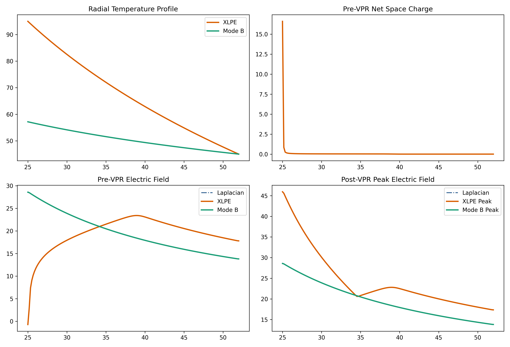

# hvdc-graded-dielectric-sim-poc

[-blue.svg)](#)
[](#)
[](https://gemini.google.com/)
[](https://colab.research.google.com/github/Abhishek1033ubuntu/hvdc-graded-dielectric-sim-poc/blob/main/src/hvdc_modeb_sim_poc.ipynb)

**Primary Author:** Abhishek Singh  
**ORCID:** https://orcid.org/0009-0004-6913-096X  
**GitHub:** https://github.com/Abhishek1033ubuntu  
**Co-Author / AI Research Collaborator:** Google Gemini (https://gemini.google.com/)  
**Repository:** https://github.com/Abhishek1033ubuntu/hvdc-graded-dielectric-sim-poc  
**Colab Notebook (`src/`):** https://colab.research.google.com/github/Abhishek1033ubuntu/hvdc-graded-dielectric-sim-poc/blob/main/src/hvdc_modeb_sim_poc.ipynb  
**Sponsorship & Support:** https://www.paypal.me/Abhishek1033ubuntu  

---

## 1. Case Study & International Engineering Context
Extruded solid polymeric insulation in High-Voltage Direct Current (HVDC) submarine and underground transmission cables (such as cross-linked polyethylene [XLPE] and polypropylene compounds) operates under intense DC electric stress combined with heavy conductor Joule heating. This operational regime is the central focus of international CIGRE working groups and IEC HVDC cable qualification frameworks:

- **CIGRE Working Group B1.56 / Technical Brochure 496 & 852:** Recommendations for Testing DC Extruded Cable Systems for Power Transmission at a Rated Voltage up to 500 kV / 800 kV (https://www.cigre.org/)
- **CIGRE Working Group D1.23:** Space Charge Measurements in Solid Dielectrics under DC Voltage (https://www.cigre.org/)
- **IEC TS 62758 / IEC 62895:** Calibration of space-charge measuring equipment (Pulsed Electro-Acoustic [PEA] method) and High-Voltage Direct Current (HVDC) power cables with extruded insulation (https://www.iec.ch/)
- **IEEE Std 3207 / IEEE Dielectrics and Electrical Insulation Society (DEIS):** Space-charge accumulation and electrical treeing diagnostics in HVDC polymeric dielectrics (https://ieeexplore.ieee.org/)

---

## 2. The Core Engineering Challenge
In solid polymeric HVDC insulation, steady-state electric field distribution is governed by electrical conductivity rather than relative permittivity:

1. **Radial Temperature Gradient (dT/dr):** Heavy conductor load current creates a steep radial temperature drop from the hotter inner conductor screen toward the cooler outer insulation screen.
2. **Spatial Conductivity Gradient & Space-Charge Accumulation:** Because polymer hopping conductivity rises exponentially with temperature and shallow trap states (0.4 - 0.8 eV) release charge carriers easily under heat, a large conductivity gradient develops across the cable wall. Injected homocharge and bulk heterocharge accumulate rapidly.
3. **Electric Field Inversion & Voltage Polarity Reversal (VPR) Overstress:** Space-charge distortion depresses the electric field at the inner conductor and shifts peak stress outward (field inversion). When line power flow reverses via Voltage Polarity Reversal (+525 kV to -525 kV), trapped space charges add constructively to the reversed geometric field, spiking local electric stress far above design limits.
4. **Partial Discharge (PD) & Electrical Treeing:** When localized fields exceed breakdown thresholds at micro-voids or semicon protrusions, hot electrons (> 3.6 eV) cleave weak aliphatic C-C polymer bonds, nucleating partial discharges and destructive electrical trees.

---

## 3. Mitigation Architecture (Mode B: To Be Developed / Not Yet POC'd)
To solve these coupled electro-thermal failure mechanisms at the subatomic and molecular level, this Simulated POC models **Mode B**—a radially graded polymeric-nanocomposite dielectric (**status: to be developed / not yet POC'd** experimentally):

- **High-Bond-Energy Backbone Matrix:** Segmented Perfluorocyclobutyl (PFCB) / Trifluoropropyl-Methyl Oligosiloxane / Fluorinated Polyimide (6FDA-TFMB) block terpolymer cured via additive [2+2] thermal cyclodimerization of trifluorovinyl ether (TFVE) end-caps (zero peroxide or condensation byproducts). Replaces weak C-C bonds (3.6 eV) with C-F (4.92 eV), Si-O (4.68 eV), and aromatic imide (> 5.2 eV) linkages to block hot-electron bond scission.
- **Isolated Ultra-Deep Electronic Traps:** Covalently tethered hexafluoroisopropylidene (-C(CF3)2-) and imide carbonyl groups spaced at ~1.31 nm create isolated deep electron traps (1.95 eV) and deep hole traps (1.80 eV) without tunneling percolation, forming a homocharge barrier at the semicon interface.
- **Isotopically Purified Phonon Channels:** 1.2 vol% edge-silanized, isotopically enriched 11B15N nanosheets (> 99% isotopic purity) eliminate phonon-isotope mass scattering, boosting radial thermal conductivity from 0.28 W/(m*K) to 1.15 W/(m*K) while preserving an ultra-wide bandgap (~6.0 eV).
- **Radial Activation Energy Compensation Law:** During melt extrusion (145 C), a radial DC poling field (45 kV) paired with a 40 kHz ultrasonic standing wave induces dielectrophoretic radial enrichment of polar trap groups before thermal [2+2] lock-in (195 C). This grades effective activation energy radially as `Ea(r) = Ea_o * [T(r) / T_o]`, keeping bulk conductivity spatially uniform and physically eliminating electric field inversion.

---

## 4. Quantitative Mitigation Results (525 kV Simulated POC Benchmark)
Simulated across a 525 kV HVDC cable geometry (`r_i = 25.0 mm`, `r_o = 52.0 mm`, wall thickness `27.0 mm`) under severe conductor overload (`W_c = 120 W/m`, outer sheath `T_o = 45.0 C`) for 18,000 s steady-state followed by a 120 s Voltage Polarity Reversal (`+525 kV` to `-525 kV`):

| Performance Metric | Geometric Laplacian Reference | Standard XLPE Baseline | Mode B Graded Dielectric (To Be Developed) | Quantitative Improvement ("By How Much") |
| :--- | :--- | :--- | :--- | :--- |
| **Radial Temperature Drop (dT)** | 0.00 K | 49.95 K | **12.16 K** | **-75.7% reduction** (37.79 K cooler inner conductor) |
| **Peak Net Space-Charge Density (rho_max)** | 0.00 C/m^3 | 18.10 C/m^3 (1.81e+01) | **0.0000741 C/m^3 (7.41e-05)** | **-99.9996% reduction** (244,264x lower space charge) |
| **Pre-VPR Inner Conductor Field E(r_i)** | 28.67 kV/mm | -0.73 kV/mm (Reversed) | **28.58 kV/mm** | **Restored to within 0.31%** of ideal geometric field |
| **Pre-VPR Outer Screen Field E(r_o)** | 13.79 kV/mm | 17.80 kV/mm (+29.1% Inverted) | **13.81 kV/mm** | **Eliminated outer-wall field inversion** (within 0.15% of ideal) |
| **Post-VPR Peak Electric Field |E|_max** | 28.67 kV/mm | 45.95 kV/mm (+60.3% Overshoot) | **28.58 kV/mm** | **-37.8% reduction in peak VPR stress** (-17.37 kV/mm) |
| **Field Enhancement Factor (f_E = |E|_max / E_lap_i)** | 1.00 | 1.60 (High treeing risk) | **0.997 (~1.00)** | **Complete elimination of space-charge field enhancement** |

---

## 5. Verification Plot & Quickstart


Run directly in Google Colab via `src/hvdc_modeb_sim_poc.ipynb` (badge at top), or execute the standalone solver script in Python:

    python src/hvdc_modeb_calibrated_solver.py

---

## 6. Intellectual Property & Research Scope Notice
- **Simulated POC Scope:** All numerical results in this repository represent a computational/in silico Proof-of-Concept based on coupled cylindrical electro-thermal and bipolar charge-transport physics.
- **Experimental Status:** The Mode B polymer-nanocomposite material and field-assisted radial curing line are **to be developed / not yet POC'd** physically.
- **Citations:** Detailed literature citations are withheld in `References.md` to safeguard proprietary intellectual property and are available upon request.

---

## 7. Repository Structure

```
hvdc-graded-dielectric-sim-poc/
├── README.md
├── References.md
├── LICENSE
├── CITATION.cff
├── src/
│   ├── hvdc_modeb_calibrated_solver.py
│   └── hvdc_modeb_sim_poc.ipynb
├── results/
│   └── hvdc_modeb_radial_profiles.png
└── docs/
    └── synthesis_and_poc_protocol.md
```
